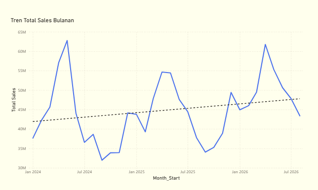
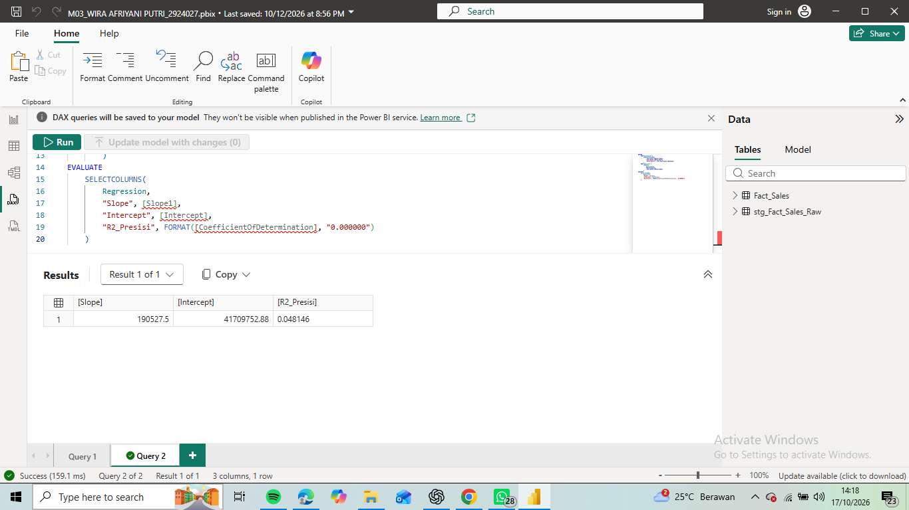

# Kecerdasan Bisnis — Praktikum 02 & 03

**Nama:** Wira Afriyani Putri  
**NIM:** 2924027  
**Mata Kuliah:** Kecerdasan Bisnis  
**Tools:** Microsoft Power BI Desktop, Power Query, DAX, dan GitHub

## Deskripsi Proyek

Repository ini berisi dokumentasi Praktikum 02 dan Praktikum 03 mata kuliah Kecerdasan Bisnis menggunakan dataset simulasi SumbarMart 360.

Praktikum mencakup pemeriksaan kualitas data, pembersihan data transaksi, visualisasi tren penjualan bulanan, serta analisis regresi linier menggunakan Microsoft Power BI.

## Praktikum 02 — Arsitektur BI dan Data Profiling

Pada Praktikum 02 dilakukan impor enam tabel Excel, pemeriksaan kualitas data menggunakan Power Query, serta identifikasi permasalahan data sebelum proses cleaning.

**Hasil:**
- Audit enam tabel sumber data.
- Identifikasi indikasi transaksi duplikat, nilai kosong, dan ketidakkonsistenan kategori.
- Diagram arsitektur Excel → Power Query → Model → DAX → Report.
- Laporan audit profiling dalam format PDF.

Dokumentasi: [Praktikum 02](Praktikum_02/)

## Praktikum 03 — Data Cleaning dan Regresi Linier

Pada Praktikum 03 dilakukan pembersihan data transaksi menggunakan Power Query, pembuatan visualisasi tren penjualan bulanan, dan regresi linier menggunakan fungsi DAX LINESTX.

**Hasil:**
- Transaksi awal: 15.734 baris.
- Transaksi setelah penghapusan duplikat: 15.712 baris.
- Standardisasi Channel menjadi Toko, Online, dan WhatsApp.
- Pembersihan format tanggal, harga, dan diskon.
- Mempertahankan 282 nilai null pada Satisfaction_Score.
- Visualisasi tren penjualan selama 32 bulan.
- Slope regresi: Rp190.527,50 per bulan.
- Intercept: Rp41.709.752,88.
- Koefisien determinasi (R²): 0,048146.

Hasil regresi menunjukkan kecenderungan tren penjualan positif, tetapi hubungan linier antara waktu dan penjualan masih lemah.

Dokumentasi: [Praktikum 03](Praktikum_03/)

## Bukti Visualisasi

### Grafik Tren Total Sales Bulanan

### Hasil Regresi LINESTX

## Catatan Dataset

Dataset yang digunakan merupakan data simulasi untuk keperluan pembelajaran. Folder data mentah dan data bersih dikecualikan dari pelacakan Git sesuai file `.gitignore` yang diberikan dosen.

## Kesimpulan

Praktikum ini menunjukkan penerapan Business Intelligence mulai dari pemeriksaan kualitas data hingga analisis tren penjualan. Proses data cleaning membantu meningkatkan konsistensi data, sedangkan visualisasi dan regresi linier memberikan gambaran mengenai pola perubahan penjualan selama periode pengamatan.
